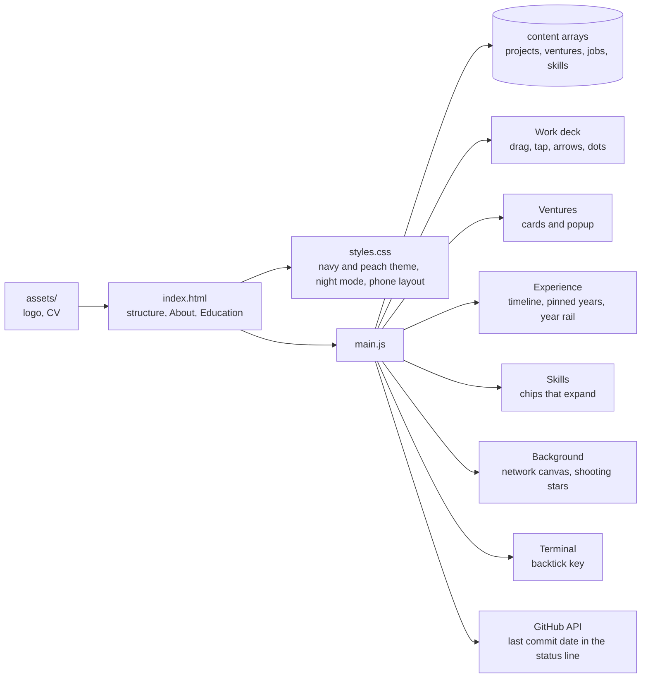

# my-portfolio

Personal portfolio of Nick Azaria, IT and cybersecurity professional based in Kigali.

Live site: https://the-genius-man.github.io/my-portfolio/

## What is inside

- `index.html`: page structure and the static sections (About, Education).
- `styles.css`: the navy and white design, peach accents, night mode, animations and phone layout.
- `main.js`: content for Work, Ventures, Experience and Skills; the living network background, stacked project cards (drag, tap or arrow keys), venture popups, the timeline with pinned years and a year rail, skill chips with tooltips, the count-up numbers, night mode, the hidden terminal (press the backtick key) and the status line, which reads the last commit date from the GitHub API.
- `assets/logo.png`: the N Azaria monogram.
- `assets/Nick_Azaria_CV.pdf`: the downloadable CV linked from the menu. Replace this file to update it.

No build step and no dependencies. Open `index.html` in a browser to run it locally.

## How the page is put together

## Updating content

Projects, ventures, roles and skills live in the arrays at the top of `main.js`. Edit them there and push; GitHub Pages republishes automatically.
